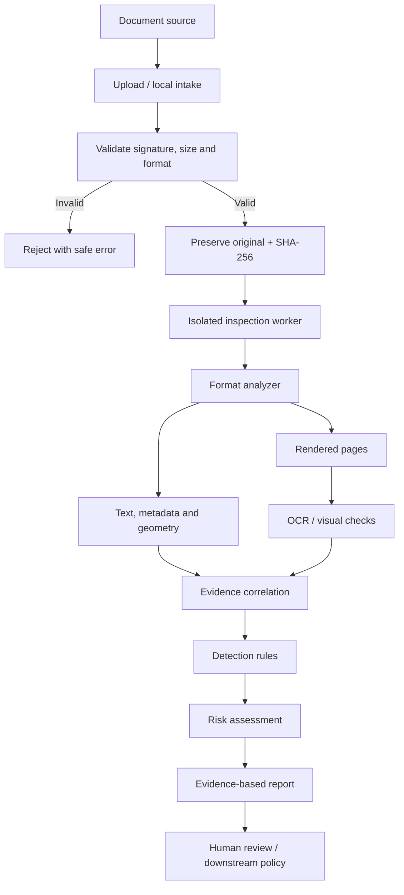
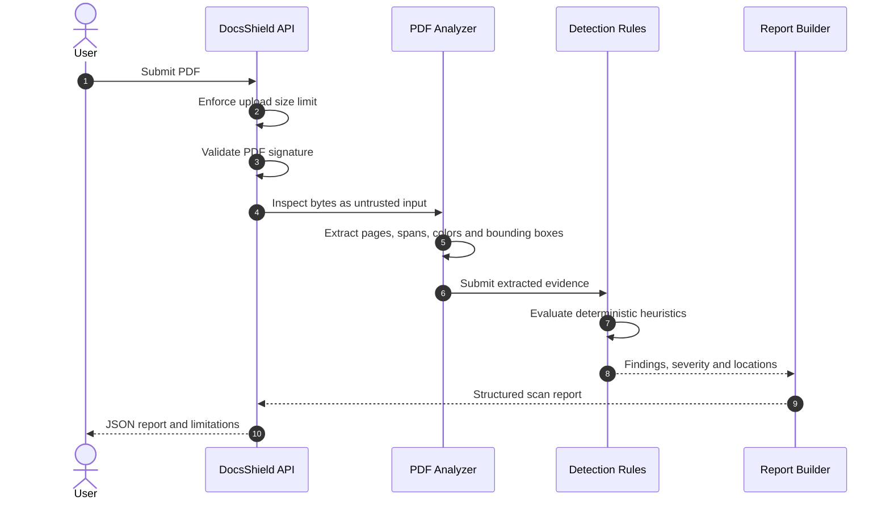

# DocsShield

**Inspect documents before they reach an AI model.**

DocsShield is an open-source document security project designed to identify hidden, visually deceptive, and suspicious content in files that people or applications intend to submit to AI systems.

A document can look ordinary to a person while containing additional text in its internal structure: white text on a white background, tiny text, off-page content, hidden Word runs, comments, tracked changes, or instructions embedded in other document elements. Depending on how a downstream AI system extracts and interprets the file, this content may influence its response.

DocsShield is being built as a **defensive inspection layer** between document sources and AI workflows.

> **Current status: pre-alpha.** The first PDF inspection foundation is under development. The project is not production-ready, does not guarantee that a document is safe, and must not be used as the sole basis for legal, financial, medical, employment, or other high-impact decisions.

---

## Contents

- [Why DocsShield exists](#why-docsshield-exists)
- [Detection scope](#detection-scope)
- [How it works](#how-it-works)
- [Inspection workflows](#inspection-workflows)
- [Architecture](#architecture)
- [Repository structure](#repository-structure)
- [Supported formats and roadmap](#supported-formats-and-roadmap)
- [Current implementation](#current-implementation)
- [Run locally](#run-locally)
- [API](#api)
- [Security and privacy](#security-and-privacy)
- [Development and tests](#development-and-tests)
- [Releases](#releases)
- [Contributing](#contributing)
- [License](#license)

## Why DocsShield exists

Prompt injection is not limited to text typed directly into a chat window. It can also arrive indirectly through external content that an AI system is asked to summarize, classify, extract, or reason about.

Examples of document-level risks include:

- White or near-white text placed over a similarly colored background.
- Extremely small text that is difficult for a person to notice.
- Text positioned outside the visible page area.
- Hidden content in document structures, layers, comments, or revision history.
- Invisible Unicode characters or unusual text encodings.
- Instructions embedded in images or other objects.
- Differences between a document's rendered appearance and its extracted text.

A simple keyword search is not enough. DocsShield is designed to inspect the document's structure and visual representation, then correlate the evidence.

## Detection scope

Detection is layered. Individual signals are not automatically proof of malicious intent.

| Detection family | Examples | Evidence |
|---|---|---|
| Visual concealment | White/light text, low contrast, transparency | Text color, opacity where available, geometry, rendered-page comparison |
| Geometric concealment | Tiny text, off-page or clipped text | Font size, bounding box, page dimensions |
| Hidden document content | Hidden runs, comments, revisions, hidden slides/sheets | Package part, XML properties, object location |
| AI-directed language | Requests to ignore instructions, reveal secrets, or change the task | Exact extracted snippet, location, matched rule |
| Extraction/render mismatch | Text extracted by a parser but not apparent in rendered output | Extracted text, rendered page, OCR comparison |
| Embedded content | Attachments, images, objects, annotations | Object metadata, extraction status, content hash |

The initial PDF milestone implements deterministic signals for text color, font size, page geometry, and suspicious instruction patterns. It does **not yet** verify actual text/background contrast, inspect all PDF objects, or perform OCR.

## How it works

DocsShield follows a **preserve, inspect, correlate, report** model:

1. **Receive** a file through an API or a future web/local interface.
2. **Validate** file size and actual file signature; do not trust the filename or browser-provided MIME type.
3. **Preserve** the original as the reference artifact and calculate its SHA-256 fingerprint.
4. **Inspect** the file using a format-specific analyzer.
5. **Extract and render** text, metadata, geometry, and page images; run OCR when needed.
6. **Correlate** extracted content with what is visually represented.
7. **Detect** suspicious properties using deterministic, explainable rules.
8. **Report** findings with location, evidence, detector ID, severity, confidence, and limitations.
9. **Review** the findings before the document enters an AI workflow.

## Inspection workflows

### High-level pipeline



> The isolated worker, rendering/OCR correlation, and downstream workflow are target architecture. The current PDF API parses synchronously in the API process and is for development only.

### Current PDF scan sequence



### Finding lifecycle

Each finding should be independently reviewable and carry, where available:

- Stable detector ID and human-readable title.
- Severity and confidence as separate fields.
- Page number and element coordinates.
- The smallest useful evidence snippet.
- Measured properties such as color, font size, or bounding box.
- Explanation of why the signal was raised.
- Whether the signal is deterministic, heuristic, or requires visual review.

A clean report must also disclose what was not inspected. **No findings does not mean no risk.**

## Architecture

DocsShield separates the user experience from the inspection engine. Web and local/private deployments are intended to use the same core analysis logic.

| Component | Technology | Responsibility | Status |
|---|---|---|---|
| Web interface | Next.js + TypeScript | Upload, scan history, evidence viewer | Planned |
| API | Python + FastAPI | Validation, scan orchestration, report endpoints | Initial |
| PDF analysis | PyMuPDF | Text spans, font sizes, colors, geometry | Initial |
| DOCX analysis | python-docx + lxml | OOXML parts, styles, revisions, hidden text | Planned |
| OCR | Tesseract | Text recognition from rendered pages/images | Planned |
| Background jobs | Celery + Redis | Asynchronous inspection | Planned |
| Metadata database | PostgreSQL | Users, jobs, findings, audit records | Planned |
| File storage | Local filesystem / S3-compatible | Original files and derived artifacts | Planned |
| Packaging | Docker | Reproducible local and hosted deployments | Planned |

### Architectural principles

- **One inspection core:** hosted and local deployments must not fork detection behavior.
- **Untrusted input boundary:** uploaded files are hostile until safely parsed.
- **No document-driven actions:** document text is data, never an instruction to the scanner.
- **Deterministic first:** baseline detections should be explainable and reproducible.
- **Human review:** findings inform decisions; they do not make high-impact decisions.
- **Privacy by design:** private/local processing is a first-class deployment mode.
- **Defense in depth:** parser isolation, resource limits, format validation, and downstream AI controls complement detection.

## Repository structure

The repository is being expanded incrementally. The intended layout is:

```text
DocsShield/
├── .github/workflows/          # CI and release automation
├── apps/
│   ├── api/                    # FastAPI service
│   │   ├── src/docshield_api/
│   │   │   ├── main.py
│   │   │   └── pdf_inspector.py
│   │   └── tests/
│   └── web/                    # Planned Next.js application
├── core/                       # Shared inspection engine (planned)
│   ├── analyzers/
│   ├── detectors/
│   ├── extraction/
│   ├── rendering/
│   ├── correlation/
│   ├── risk/
│   └── reporting/
├── workers/                    # Isolated asynchronous workers (planned)
├── docs/
│   └── architecture.md
├── CHANGELOG.md
├── LICENSE
├── README.md
└── SECURITY.md
```

## Supported formats and roadmap

| Format | Status | Planned inspection |
|---|---|---|
| PDF | Initial implementation | Text spans, colors, font sizes, geometry, suspicious phrases, rendering and structure |
| DOCX | Planned | OOXML/XML, hidden runs, styles, comments, tracked changes, headers, footers, embedded objects |
| XLSX | Planned | Hidden sheets/rows/columns, comments, cell styles, drawings, embedded objects |
| PPTX | Planned | Hidden slides, notes, off-slide elements, text styling, embedded objects |
| PNG / JPEG / TIFF | Planned | OCR, image metadata, visual inspection |
| EML / HTML | Research | Hidden markup, quoted content, embedded instructions |

### Milestones

- [x] Public repository foundation.
- [x] Apache License 2.0.
- [x] Security policy and initial architecture notes.
- [x] FastAPI health endpoint and CI workflow.
- [x] Initial PDF span extraction and deterministic heuristic rules.
- [x] PDF upload endpoint with size and signature validation.
- [x] Initial PDF detector tests.
- [ ] PDF rendering and OCR correlation.
- [ ] PDF object, annotation, attachment, layer, and transparency analysis.
- [ ] DOCX package/XML analyzer.
- [ ] Unified finding schema and calibrated risk assessment.
- [ ] Asynchronous isolated workers.
- [ ] Web dashboard and evidence viewer.
- [ ] Local Docker deployment.
- [ ] S3-compatible hosted deployment.
- [ ] Adversarial benchmark corpus and documented detection metrics.
- [ ] First tagged pre-release after functionality is validated.

## Current implementation

The current API includes:

- `GET /health`: API process health check.
- `POST /v1/scans/pdf`: upload and inspect a PDF (20 MiB request limit).
- PDF text-span extraction.
- Heuristics for very light text, tiny text (below 3 pt), and text bounding boxes outside page boundaries.
- Heuristic patterns for possible instruction override, role manipulation, data exfiltration, and task redirection.
- SHA-256 fingerprint and structured findings with page coordinates.
- Explicit coverage and limitation fields in the JSON report.
- Pytest coverage for clean PDFs, each initial detector family, and API upload validation.

### Current PDF detector rules

| Detector ID | Signal | Initial severity | Limitation |
|---|---|---|---|
| `pdf.visual.light_text` | Very light text color | Low | Background pixels are not compared |
| `pdf.geometry.tiny_text` | Font size below 3 pt | Medium | Legitimate footnotes may trigger |
| `pdf.geometry.off_page_text` | Span bounding box outside page | Medium | Intentional bleed may trigger |
| `prompt.override_instructions` | Instruction override phrase | High | Pattern match is not semantic proof |
| `prompt.role_manipulation` | Role/persona manipulation phrase | High | Context may be benign |
| `prompt.data_exfiltration` | Request to reveal secrets | High | Context determines intent |
| `prompt.task_redirection` | AI-directed conditional phrase | High | Heuristic coverage is incomplete |

Severity is a review priority, not a probability or legal conclusion. Confidence is represented separately.

## Run locally

Requirements:

- Python 3.11 or newer.
- Git.

From the repository root:

**Windows PowerShell**

```powershell
cd apps/api
py -3.11 -m venv .venv
.\.venv\Scripts\Activate.ps1
python -m pip install --upgrade pip
python -m pip install -e ".[dev]"
uvicorn docshield_api.main:app --reload
```

**Linux / macOS**

```bash
cd apps/api
python3.11 -m venv .venv
source .venv/bin/activate
python -m pip install --upgrade pip
python -m pip install -e ".[dev]"
uvicorn docshield_api.main:app --reload
```

Open:

- API health: http://127.0.0.1:8000/health
- Interactive API docs: http://127.0.0.1:8000/docs

## API

### Health check

```bash
curl http://127.0.0.1:8000/health
```

### Scan a PDF

```bash
curl -X POST "http://127.0.0.1:8000/v1/scans/pdf" \
  -F "file=@./sample.pdf"
```

The endpoint returns JSON containing:

- `file`: detected format, SHA-256, byte size, and page count.
- `summary`: number of findings, highest severity, and extracted character count.
- `findings`: detector ID, title, severity, confidence, page, excerpt, bounding box, explanation, and evidence.
- `coverage`: checks performed and checks not yet implemented.
- `limitations`: important interpretation and coverage warnings.

Invalid files return HTTP 422. Empty files return HTTP 400. Files exceeding the 20 MiB limit return HTTP 413.

The endpoint is synchronous and intended for development only. Production deployment requires isolated processing workers, stronger resource controls, authentication, retention policies, and operational monitoring.

## Security and privacy

Documents are untrusted input. A parser vulnerability can compromise a process even when the application never executes document macros or scripts. Production processing therefore requires layered controls.

Planned controls include:

- File signature validation and allowlisted formats.
- Upload size, page count, decompression, CPU, memory, and wall-clock limits.
- Parser execution in isolated workers/containers.
- No outbound network access for document-processing workers by default.
- Safe temporary-file handling and deterministic cleanup.
- No use of user filenames as filesystem paths.
- Explicit retention and deletion policies.
- Encryption in transit and at rest in hosted deployments.
- Audit events that avoid logging document contents unnecessarily.
- Dependency and container vulnerability scanning.

The current development API is not hardened for confidential or production documents. Do not upload sensitive material to an untrusted deployment.

### Responsible use

Only inspect documents you own or are authorized to process. Report security vulnerabilities privately according to [SECURITY.md](SECURITY.md).

## Development and tests

From `apps/api`:

```bash
python -m pip install -e ".[dev]"
ruff check .
pytest
```

Detection quality will be measured using:
- Precision and recall.
- False positive and false negative rates by attack technique.
- Performance by file size and page count.
- Parser robustness and resource consumption.

Test fixtures should be synthetic and must not contain confidential documents or personal data.

## Releases

DocsShield uses version tags in the form `vMAJOR.MINOR.PATCH`.

The GitHub Actions release workflow is configured to publish GitHub pre-releases when a version tag beginning with `v` is pushed. A release should only be created after its stated functionality has been implemented and validated.

See [CHANGELOG.md](CHANGELOG.md) for project changes.

## Contributing

Contributions are welcome. Before opening a pull request:

1. Review the architecture and security principles.
2. Add or update tests for changed behavior.
3. Run Ruff and Pytest.
4. Document detection limitations and possible false positives.
5. Never include confidential documents, secrets, or personal data in fixtures.

Contributions are distributed under the repository's [Apache License 2.0](LICENSE), subject to its terms.

## License

DocsShield is licensed under the [Apache License, Version 2.0](LICENSE).

## Disclaimer

DocsShield is provided for defensive inspection and research. It does not guarantee detection of every hidden instruction, prompt injection, or malicious document feature. Detection may produce false positives and false negatives. A clean report is not a certification of safety and does not replace human review, secure AI integration practices, or professional judgment.
